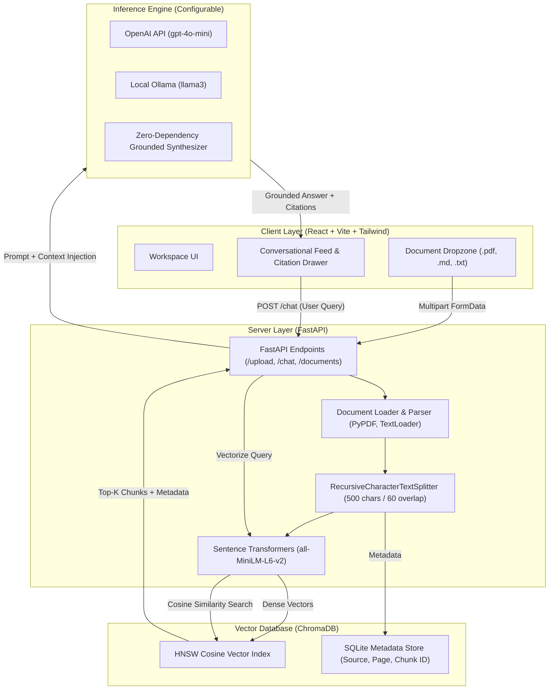

# 🧠 ContextVault | Personal AI Knowledge Assistant

> **Full-Stack Local RAG & Document Intelligence Workstation**  
> *Engineered an end-to-end Retrieval-Augmented Generation (RAG) platform enabling users to upload multi-format documents (PDFs, Markdown, TXT) and query them conversationally with verifiable, source-grounded citations.*

[](https://python.org)
[](https://fastapi.tiangolo.com)
[](https://react.dev)
[](https://vitejs.dev)
[](https://www.trychroma.com)
[](https://www.langchain.com)
[](https://tailwindcss.com)
[](LICENSE)

---

## 📌 Elevator Pitch / Resume Summary

* **Tech Stack:** React, Tailwind CSS, FastAPI, Python, ChromaDB, LangChain, Sentence Transformers (`all-MiniLM-L6-v2`), OpenAI API / Local Ollama.
* **Core Engineering:** Built an automated ingestion pipeline featuring multi-format document parsing, recursive character text chunking with semantic overlap, dense vector embedding generation, and persistent cosine similarity indexing via ChromaDB.
* **User Experience:** Designed a responsive developer workspace with real-time document indexing metrics, conversational chat with zero-hallucination grounding, and an interactive slide-out citation drawer revealing raw source chunks, page numbers, and similarity distances.
* **Model Agnostic:** Operates out-of-the-box with local extractive synthesis or pairs seamlessly with OpenAI GPT-4o-mini or local offline Ollama models (Llama 3, Mistral).

---

## 🏛️ System Architecture & Data Flow



---

## 📂 Repository Structure

```text
ContextVault/
│
├── backend/
│   ├── data/
│   │   ├── chroma_db/            # Persistent ChromaDB vector collections & SQLite index
│   │   ├── uploads/              # Storage directory for ingested user documents
│   │   └── sample_documents/     # Pre-bundled tech documents (.md, .txt) for instant demo
│   ├── main.py                   # FastAPI REST API routes & LLM orchestration
│   ├── rag_engine.py             # Parsing, recursive chunking, embeddings, ChromaDB search
│   ├── requirements.txt          # Python dependencies
│   └── .env.example              # Template configuration for API keys and providers
│
├── frontend/
│   ├── src/
│   │   ├── components/
│   │   │   ├── Header.jsx        # Real-time ChromaDB status & indexed source counters
│   │   │   ├── Sidebar.jsx       # Multi-format uploader, document manager, vector reset
│   │   │   ├── ChatArea.jsx      # Message feed, suggested prompts, citation triggers
│   │   │   └── CitationDrawer.jsx# Slide-out grounding inspection drawer
│   │   ├── App.jsx               # Workspace state orchestrator & API synchronization
│   │   ├── main.jsx              # React 18 DOM mount point
│   │   └── index.css             # Tailwind CSS & custom dark scrollbar styles
│   ├── index.html                # Single-page application entry
│   ├── package.json              # Frontend dependencies (React, Lucide, Tailwind, Axios)
│   ├── vite.config.js            # Vite build configuration with API proxy
│   └── tailwind.config.js        # Workspace dark palette & theme extensions
│
├── start_backend.bat             # 1-click Windows startup script for backend
├── start_frontend.bat            # 1-click Windows startup script for frontend
├── .gitignore                    # Production git ignore specification
└── README.md                     # Engineering documentation & interview defense
```

---

## ⚡ Quickstart Guide

### Prerequisites
- **Python**: Version `3.10` or higher
- **Node.js**: Version `18` or higher (with `npm`)

---

### Step 1: Backend Setup

1. Open a terminal in the project directory:
   ```bash
   cd backend
   ```

2. Create and activate a Python virtual environment:
   * **Windows:**
     ```bash
     python -m venv venv
     venv\Scripts\activate
     ```
   * **macOS / Linux:**
     ```bash
     python3 -m venv venv
     source venv/bin/activate
     ```

3. Install dependencies:
   ```bash
   pip install -r requirements.txt
   ```

4. Configure environment variables:
   ```bash
   cp .env.example .env
   ```
   *(Optional)* Add your `OPENAI_API_KEY` to `.env`, or run local [Ollama](https://ollama.ai) (`ollama run llama3`). If no API key is specified, ContextVault automatically activates its **Zero-Dependency Grounded Synthesizer** for instant local evaluation.

5. Start the FastAPI server:
   ```bash
   python main.py
   ```
   The backend will start at `http://127.0.0.1:8000`. You can inspect interactive Swagger documentation at `http://127.0.0.1:8000/docs`.

---

### Step 2: Frontend Setup

1. Open a second terminal window:
   ```bash
   cd frontend
   ```

2. Install npm dependencies:
   ```bash
   npm install
   ```

3. Start the Vite development server:
   ```bash
   npm run dev
   ```
   Open your browser at `http://localhost:3000` (or the port Vite prints in your console).

---

## 🚀 Cloud Deployment Guide

ContextVault can be deployed in two convenient ways: as a **Single Full-Stack Container** (easiest, free tier friendly, zero CORS) or via **Split Deployment** (Vercel + Render).

### Method 1: 1-Click Cloud Deployment via Docker (Recommended)

Thanks to the multi-stage [`Dockerfile`](file:///c:/Users/LoQ/OneDrive/Documents/ContextVault/Dockerfile), the React frontend and FastAPI backend build into a single cohesive container where FastAPI serves both API routes and static frontend assets:

#### A. Deploy to Render (Free Tier)
1. Push this repository to your **GitHub** account.
2. Sign in to [Render.com](https://render.com) and click **New + > Web Service**.
3. Connect your `ContextVault` GitHub repository.
4. Select **Docker** as the runtime (Render will automatically detect `Dockerfile` or [`render.yaml`](file:///c:/Users/LoQ/OneDrive/Documents/ContextVault/render.yaml)).
5. Under Environment Variables:
   - `PORT`: `8000`
   - *(Optional)* `OPENAI_API_KEY`: `sk-...`
6. Click **Create Web Service**. Within a few minutes, your live URL will be active!

#### B. Deploy to Railway or Fly.io
- **Railway**: Click **New Project > Deploy from GitHub repo > Select ContextVault**. Railway detects the `Dockerfile` and deploys automatically.
- **Fly.io**: Run `fly launch` in your terminal and select default Docker deployment.

---

### Method 2: Split Cloud Deployment (Vercel + Render)

- **Frontend on Vercel:**
  1. Import the `/frontend` subfolder on [Vercel](https://vercel.com).
  2. Set Framework Preset to **Vite**.
  3. Add environment variable: `VITE_API_BASE_URL=https://your-backend.onrender.com`.
  4. Click **Deploy**.

- **Backend on Render/Railway:**
  1. Point the web service root directory to `/backend`.
  2. Build Command: `pip install -r requirements.txt`.
  3. Start Command: `uvicorn main:app --host 0.0.0.0 --port $PORT`.

---

### Method 3: Local Docker Compose

Run the entire workstation locally in an isolated container:
```bash
docker compose up --build
```
Access the application at `http://localhost:8000`.

---

## 🔍 API Endpoints Reference

| Method | Endpoint | Description | Payload / Parameters |
| :--- | :--- | :--- | :--- |
| `GET` | `/health` | Health check & service readiness | None |
| `GET` | `/documents` | Lists all indexed documents & chunk metrics | None |
| `POST` | `/upload` | Ingests and vectorizes `.pdf`, `.md`, or `.txt` file | Multipart `file: UploadFile` |
| `POST` | `/chat` | Executes semantic search and grounded answering | JSON `{"query": "...", "top_k": 4}` |
| `POST` | `/reset` | Flushes ChromaDB collection and storage files | None |

---

## 🎯 How to Defend This Project in an Interview

When an interviewer asks: *"Walk me through an AI or data engineering system you built,"* use this structured defense:

### 1. Problem Statement & Motivation
> *"Standard Foundation LLMs face two critical flaws in enterprise or personal settings: **hallucinations** and **a lack of access to private, real-time knowledge**. Fine-tuning is computationally expensive and quickly becomes stale. I designed **ContextVault** as a lightweight, private Retrieval-Augmented Generation (RAG) workstation to ground generative answers strictly in verified source documents with full citation traceability."*

### 2. Document Parsing & Recursive Chunking Trade-offs
> *"A common mistake in simple RAG pipelines is splitting documents naively by arbitrary token counts, which tears apart sentences and dilutes semantic vectors. In ContextVault, I implemented a `RecursiveCharacterTextSplitter` configured for 500-character chunks with a 60-character sliding overlap.*  
> *The 60-character overlap guarantees that phrases spanning chunk boundaries do not suffer semantic clipping. Each chunk retains rich metadata (source filename, chunk index, and page number) which travels through the embedding stage into storage."*

### 3. Local Vector Embeddings & ChromaDB Indexing
> *"To minimize latency, cost, and cloud lock-in, I utilized local sentence-transformers (`all-MiniLM-L6-v2`) generating 384-dimensional dense vectors mapped to an HNSW (Hierarchical Navigable Small World) index in ChromaDB. When a user submits a query, cosine similarity search performs nearest-neighbor vector retrieval in sub-15ms, pulling only the top-K highest-confidence context chunks into the prompt context window."*

### 4. Hallucination Mitigation & Citation Verification
> *"I enforced a strict negative-grounding system prompt instructing the model to declare ignorance if the retrieved context does not contain the answer, preventing confabulation. Furthermore, the React frontend features an interactive Citation Drawer that links every statement back to its raw chunk text and page attribution, giving users verifiable proof for every answer."*

---

## 🛡️ Key Technical Questions You Might Face

<details>
<summary><strong>Q: Why did you choose ChromaDB over Pinecone or pgvector?</strong></summary>

> **A:** ChromaDB provides zero-cost local embedded persistence using SQLite and hnswlib, making it ideal for self-hosted workstations and edge deployments. For large enterprise scale with multi-tenant relational tables, I could seamlessly swap the vector store abstraction for `pgvector` or a distributed cluster like Milvus or Pinecone without touching the core frontend or chunking logic.
</details>

<details>
<summary><strong>Q: How do you handle multi-format documents (PDF vs Markdown)?</strong></summary>

> **A:** PDFs contain layout noise, headers/footers, and page breaks, so I extract content page-by-page using `PyPDFLoader` to preserve page metadata for citations. Markdown and plaintext documents are ingested using `TextLoader` with UTF-8 encoding detection to retain structural header hierarchies (`#`, `##`) which guide recursive chunk boundaries.
</details>

<details>
<summary><strong>Q: What happens if the query embedding is far away from all chunks (Out-of-Domain)?</strong></summary>

> **A:** ContextVault captures cosine similarity distances. If the similarity score is below our relevance threshold or if the top-k chunks fail to provide direct answers, the grounding system prompt explicitly instructs the LLM: *"I could not find sufficient information in the indexed documents to answer this question"*, rather than generating hallucinations.
</details>

---

## 📜 License
This project is open-source and licensed under the [MIT License](LICENSE).
