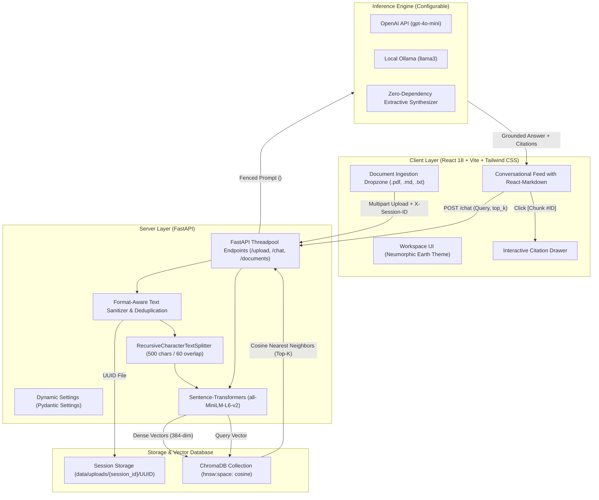

# 🧠 ContextVault | Personal AI Knowledge Assistant

[](https://contextvault-vqlc.onrender.com)

> **Full-Stack Local RAG & Document Intelligence Workstation**  
> *An end-to-end Retrieval-Augmented Generation (RAG) platform enabling users to upload multi-format documents (PDFs, Markdown, TXT) and query them with verifiable, source-grounded citations.*

[](https://python.org)
[](https://fastapi.tiangolo.com)
[](https://react.dev)
[](https://vitejs.dev)
[](https://www.trychroma.com)
[](https://www.langchain.com)
[](https://tailwindcss.com)
[](LICENSE)

---

## 📌 Resume & Engineering Summary

* **Tech Stack:** React 18, Vite, Tailwind CSS, FastAPI, Python 3.10+, ChromaDB, LangChain, Sentence-Transformers (`all-MiniLM-L6-v2`), OpenAI API / Local Ollama.
* **Core Engineering:** Built an ingestion pipeline featuring format-aware document parsing (preserving Markdown lists and code blocks), recursive character text chunking with sliding overlap (500 chars / 60 overlap), SHA-256 deduplication, dense vector embedding generation, and persistent cosine distance indexing via ChromaDB (`hnsw:space: "cosine"`).
* **Security & Multi-Tenancy:** Engineered session-isolated ChromaDB collections (`cv_<session_id>`) and segregated disk storage, streaming upload size enforcement (10MB cap with memory protection), UUID-based storage filenames protecting against path traversal (`../`), regex server path scrubbing, and structured XML prompt fencing defending against prompt injection.
* **User Experience:** Implemented an earth-toned neumorphic interface with dynamic runtime configuration discovery (`GET /api/config`), rich Markdown answer rendering (`react-markdown`), and an interactive Citation Drawer with targeted chunk highlighting and Cosine Similarity metric breakdowns.
* **Model Agnostic:** Operates out-of-the-box with a zero-dependency extractive synthesizer or connects with OpenAI GPT-4o-mini or local offline Ollama models (Llama 3, Mistral).

---

## 🏛️ System Architecture & Data Flow



---

## 📂 Repository Structure

```text
ContextVault/
│
├── backend/
│   ├── data/
│   │   ├── chroma_db/            # Persistent ChromaDB vector collections & SQLite metadata
│   │   ├── uploads/              # Session-segregated storage directory for uploaded documents
│   │   └── sample_documents/     # Pre-bundled tech documents (.md, .txt) for instant testing
│   ├── tests/
│   │   ├── conftest.py           # Deterministic fake embedder and isolated temp fixtures
│   │   ├── test_regression_bugs.py # Regression test suite for critical bug fixes
│   │   ├── test_backend_quality.py # Tests for streaming limits, config, and LLM providers
│   │   ├── test_session_and_security.py # Tests for multi-tenancy, auth, and prompt injection
│   │   ├── test_rag_quality.py   # Tests for cosine space, metric math, and threshold filtering
│   │   ├── test_rag_engine.py    # Unit tests for chunking and loaders
│   │   └── test_api_endpoints.py # Integration tests for REST routes
│   ├── config.py                 # Centralized Pydantic Settings configuration
│   ├── llm_providers.py          # Modularized LLM orchestration with timeouts and prompt fencing
│   ├── main.py                   # FastAPI REST API routes, threadpool handlers, and static mount
│   ├── rag_engine.py             # Parsing, recursive chunking, embeddings, ChromaDB search
│   ├── requirements.txt          # Pinned production Python dependencies
│   └── .env.example              # Configuration template for API keys and providers
│
├── frontend/
│   ├── src/
│   │   ├── components/
│   │   │   ├── Header.jsx        # ChromaDB status, session copy pill, and API Key modal
│   │   │   ├── Sidebar.jsx       # Multi-format uploader, document manager, vector reset
│   │   │   ├── ChatArea.jsx      # Markdown message feed, dynamic prompts, citation chips
│   │   │   └── CitationDrawer.jsx# Grounding drawer with auto-scroll and distance metrics
│   │   ├── App.jsx               # Workspace state orchestrator & API synchronization
│   │   ├── main.jsx              # React 18 DOM mount point
│   │   └── index.css             # Tailwind CSS & earth-toned neumorphic styles
│   ├── index.html                # Single-page application entry
│   ├── package.json              # Clean dependencies (react-markdown, lucide-react, tailwindcss)
│   ├── vite.config.js            # Vite build configuration with development /api proxy
│   └── tailwind.config.js        # Workspace earth-toned palette & typography
│
├── scripts/
│   └── eval_retrieval.py         # Retrieval evaluation benchmark script (Hit@1 and Hit@4)
├── run_tests.py                  # Automated test verification runner
├── Dockerfile                    # Multi-stage production container build
├── docker-compose.yml            # Local isolated container orchestration
├── render.yaml                   # Infrastructure-as-code specification for Render
├── .dockerignore                 # Excludes cache, venv, and local databases from build
├── .gitignore                    # Production git ignore specification
└── README.md                     # Engineering documentation & interview defense
```

---

## ⚡ Quickstart Guide

### Prerequisites
- **Python**: Version `3.10` or higher
- **Node.js**: Version `18` or higher (with `npm`)

---

### Step 1: Backend Setup

1. Open a terminal in the project directory:
   ```bash
   cd backend
   ```

2. Create and activate a Python virtual environment:
   * **Windows:**
     ```bash
     python -m venv venv
     venv\Scripts\activate
     ```
   * **macOS / Linux:**
     ```bash
     python3 -m venv venv
     source venv/bin/activate
     ```

3. Install dependencies:
   ```bash
   pip install -r requirements.txt
   ```

4. Configure environment variables:
   ```bash
   cp .env.example .env
   ```
   *(Optional)* Add your `OPENAI_API_KEY` to `.env`, or run local [Ollama](https://ollama.ai) (`ollama run llama3`). If no API key is specified, ContextVault automatically activates its **Zero-Dependency Extractive Synthesizer** for instant local evaluation.

5. Start the FastAPI server:
   ```bash
   python main.py
   ```
   The backend will start at `http://127.0.0.1:8000`. You can inspect interactive Swagger documentation at `http://127.0.0.1:8000/docs`.

---

### Step 2: Frontend Setup

1. Open a second terminal window:
   ```bash
   cd frontend
   ```

2. Install npm dependencies:
   ```bash
   npm install
   ```

3. Start the Vite development server:
   ```bash
   npm run dev
   ```
   Open your browser at `http://localhost:5173` (or the port Vite prints in your console).

---

## 🧪 Running Automated Tests

ContextVault comes with an extensive automated test suite covering unit tests, integration tests, regression tests, and security tests.

### Running Pytest Suite (Fast with Fake Embedder)
```bash
python -m pytest backend/tests/ -v
```
*Executes all 39 tests in under 2 seconds without requiring external model downloads.*

### Running Full Pipeline Verification (With Real Model)
```bash
python run_tests.py
```
*Executes end-to-end ingestion, vectorization, and retrieval with the actual sentence-transformer model.*

---

## 🚀 Cloud Deployment Guide

ContextVault can be deployed as a **Single Full-Stack Container** (recommended) or via **Local Docker Compose**.

### Method 1: 1-Click Cloud Deployment via Docker (Recommended)

Thanks to the multi-stage [Dockerfile](Dockerfile), the React frontend and FastAPI backend build into a single cohesive container where FastAPI serves both API routes and static frontend assets:

#### Deploy to Render (Free Tier)
1. Push this repository to your **GitHub** account.
2. Sign in to [Render.com](https://render.com) and click **New + > Web Service**.
3. Connect your `ContextVault` GitHub repository.
4. Select **Docker** as the runtime (Render detects the [Dockerfile](Dockerfile) or [render.yaml](render.yaml)).
5. Under Environment Variables:
   - `PORT`: `8000`
   - *(Optional)* `OPENAI_API_KEY`: `sk-...`
6. Click **Create Web Service**.

---

### Method 2: Local Docker Compose

Run the entire workstation locally in an isolated container:
```bash
docker compose up --build
```
Access the application at `http://localhost:8000`.

---

## 🔍 API Endpoints Reference

| Method | Endpoint | Description | Headers / Query / Body |
| :--- | :--- | :--- | :--- |
| `GET` | `/health` | Health check & service readiness | Optional: `X-API-Key` |
| `GET` | `/api/config` | Returns runtime configuration (model, limits, auth) | None |
| `GET` | `/documents` | Lists indexed documents & chunk counts for session | `X-Session-ID`, optional `X-API-Key` |
| `POST` | `/upload` | Ingests, deduplicates, and vectorizes file (10MB cap) | `Multipart file`, `X-Session-ID`, optional `X-API-Key` |
| `POST` | `/chat` | Retrieves cosine nearest neighbors and synthesizes answer | JSON `{"query": "...", "top_k": 4, "session_id": "..."}` |
| `DELETE` | `/documents/{filename}` | Removes document and its vector chunks from session | `X-Session-ID`, optional `X-API-Key` |
| `POST` | `/reset` | Flushes session ChromaDB collection and storage files | `X-Session-ID`, optional `X-API-Key` |

---

## 🎯 How to Defend This Project in an Interview

When an interviewer asks: *"Walk me through the architecture and engineering challenges of your RAG application,"* use this structured defense:

### 1. Vector Space & Metric Alignment (Cosine Distance vs Similarity)
> *"In ChromaDB, when you create a collection without specifying metadata, it defaults to squared-L2 (Euclidean distance). For text embeddings generated by normalized sentence-transformers like `all-MiniLM-L6-v2`, cosine distance is mathematically the appropriate metric.*  
> *I explicitly configured the collection with `collection_metadata={"hnsw:space": "cosine"}`. In ChromaDB, cosine distance is defined as $D = 1 - \cos(\theta)$, which ranges from 0.0 (identical) to 2.0 (opposite), with orthogonal vectors around 1.0. I implemented cosine similarity calculation as $\max(0.0, 1.0 - D)$ and set our relevance threshold filtering to $D \le 1.0$, preventing irrelevant passages from cluttering the prompt context."*

### 2. Threadpool Concurrency in FastAPI
> *"A critical mistake in async Python frameworks is declaring CPU-bound or blocking I/O endpoints with `async def`. Embedding models run PyTorch tensor operations on the CPU, and ChromaDB performs synchronous disk I/O.*  
> *If an endpoint running CPU-bound inference is declared as `async def`, it executes directly on the asyncio event loop, completely freezing the server and blocking other lightweight requests like `/health`. I solved this by declaring `/chat` and `/upload` as standard `def` endpoints, allowing FastAPI to automatically offload them to its internal `anyio` threadpool worker threads."*

### 3. Ingestion Robustness & Chunk Deduplication
> *"To ensure ingestion scalability, I implemented three safeguards: First, streaming upload size enforcement with a 64KB chunk reader that aborts with HTTP 413 if a file exceeds 10MB, unlinking the partial file to prevent disk and RAM exhaustion. Second, SHA-256 content hashing: if a user re-uploads the exact same document, the system recognizes the duplicate hash and skips re-embedding. Third, chunk batching: since ChromaDB has a maximum batch size limit (~5,461 items), our ingestion pipeline inserts vector records in chunks of 500."*

### 4. Security: Path Traversal, Multi-Tenancy & Prompt Injection
> *"I addressed security across three critical boundaries:*  
> *1. **Path Traversal:** Instead of saving uploads directly under the user-supplied filename, the backend stores files under server-generated UUIDs and preserves the original filename only as metadata.*  
> *2. **Multi-Tenancy:** Each user session is partitioned into its own ChromaDB collection (`cv_<session_id>`) and segregated directory (`data/uploads/<session_id>/`), preventing users from accessing each other's data.*  
> *3. **Prompt Injection:** Context passages are wrapped inside structured `<context>` XML boundary tags with closing tags escaped, paired with a system instruction directing the LLM to treat document text strictly as untrusted reference material."*

---

## 🛡️ Key Technical Questions & Answers

<details>
<summary><strong>Q: Why did you choose ChromaDB over Pinecone or pgvector?</strong></summary>

> **A:** ChromaDB provides zero-cost local embedded persistence using SQLite and hnswlib, making it ideal for self-hosted workstations and lightweight containerized deployments without external cloud dependencies. For enterprise relational workflows with complex RBAC, `pgvector` with PostgreSQL would be the logical next evolution.
</details>

<details>
<summary><strong>Q: How does recursive character chunking differ from naive fixed-size chunking?</strong></summary>

> **A:** Naive splitting cuts text strictly by character or token counts, often severing words, code blocks, or sentences in half. `RecursiveCharacterTextSplitter` attempts to split hierarchically by double newlines (paragraphs), then single newlines (sentences), and finally spaces (words). Our 60-character sliding overlap ensures that semantic context spanning chunk boundaries is preserved.
</details>

<details>
<summary><strong>Q: How do you handle cases where the user query has no relevant context in the uploaded documents?</strong></summary>

> **A:** ContextVault applies a two-level defense: First, retrieved chunks must satisfy our cosine distance threshold ($D \le 1.0$). If no chunks pass the threshold, the backend immediately returns a clear message stating that no relevant content was found, saving LLM tokens. Second, if chunks are returned, the system prompt strictly instructs the LLM not to speculate beyond the provided `<context>` tags.
</details>

---

## 📜 License
This project is open-source and licensed under the [MIT License](LICENSE).
